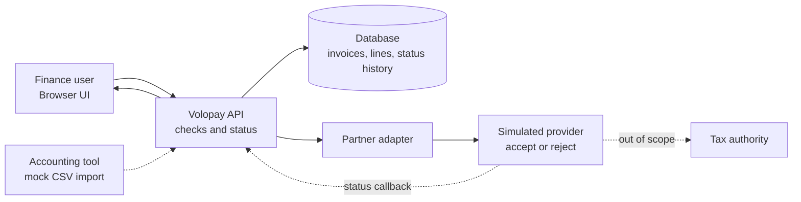

# Volopay e-invoicing prototype (UAE)

Challenge 3 of the Volopay Founder's Office assignment. Built by Komal.

A small working web prototype that shows how a finance user creates an e-invoice, how Volopay checks it before sending, how it goes through a **simulated** e-invoicing provider, and how a rejection is fixed.

**Everything that talks to a provider, tax authority or accounting tool is simulated. Nothing connects to a real system.** Say this on every screen.

---

## 1. What this proves

From the Challenge 1 strategy: Volopay adds e-invoicing to its AR and AP products. Volopay builds the checks, status handling, collections and payments. A partner (an accredited provider, ASP) provides the legal link to the tax system. The prototype shows the **send side** for the **UAE**:

- Volopay catches errors before sending.
- A provider (simulated) accepts or rejects.
- The status comes back to the user, and the user can fix and resend.

Why the UAE: it is the first market. Only an accredited provider may submit, so a partner is required. The common rejection causes are known (section 5).

---

## 2. Scope

**In scope (must have)**
1. Invoice list with sample data.
2. Create and edit an invoice.
3. Checks before sending, shown inline.
4. Submit to a simulated provider.
5. Status per invoice: timeline with provider response.
6. At least one blocked-by-check example and one provider rejection, each fixed by the user.

**Stretch (only if the must-haves work)**
- "Incoming invoices" screen: a received e-invoice shown as data, checked against a purchase order and supplier, approved. (Receive-and-pay side of the strategy.)
- Mark an invoice paid and match it to the invoice. (Collections side.)
- CSV import that mimics an export from an accounting tool.

**Out of scope**
Real provider or tax-authority connections, payments, financing, login, multi-user, Malaysia, mobile layout polish.

---

## 3. Screens

| Screen | What it shows |
|---|---|
| Invoices | Table: number, buyer, total, status chip. Button: New invoice. Button: Reset sample data. |
| Invoice form | Seller and buyer (name, TRN), invoice number, issue date, currency AED, line items (description, quantity, unit price, VAT code per line), totals. Button: Check. Button: Submit. |
| Check result | Pass or a list of errors, each with a rule ID, plain message, and the field to fix. Submit is disabled until it passes. |
| Invoice detail | Status timeline: Draft, Checked, Submitted, then Accepted or Rejected with code. Shows the raw simulated provider response, labelled. Button: Fix and resubmit. |
| Incoming (stretch) | Received invoice, match against a sample purchase order, Approve or Reject. |

A fixed banner on every screen: **SIMULATED. No real provider, tax authority or accounting system is connected.**

---

## 4. Status model

```
Draft -> Checked -> Submitted -> Accepted
             |           \-----> Rejected (code) -> edit -> Checked -> Submitted ...
             \--> Blocked (check errors, never sent)
```

- **Blocked** invoices are never sent. Volopay's checks stop them.
- **Rejected** invoices were sent and the simulated provider returned an error code.
- Each change adds an entry to a status history (timestamp, status, message).

---

## 5. Rules

### 5.1 Volopay checks (run before sending)

Source status: **S** = sourced in the research. **V** = must be verified against an official source before the prototype states it as fact. Do not present V rules as official in the UI. Label them "assumed" in a rules panel.

| ID | Check | Status |
|---|---|---|
| V-01 | Seller and buyer tax registration number (TRN) present and well-formed | S that invalid TRNs cause rejections. **V** for the exact format (believed 15 digits) |
| V-02 | VAT code set on **every line**, not only at invoice level | S (a UAE provider blog says the schema needs a tax code per line) |
| V-03 | VAT treatment consistent with the line (for example a zero-rated or exempt line must not carry the standard rate) | S that wrong VAT on mixed or zero-rated supplies causes rejections. **V** for rates and categories (standard rate believed 5%) |
| V-04 | Invoice number follows a consistent format and is unique per seller | S (non-standard numbering and duplicate records cause rejections) |
| V-05 | Required fields present (list to confirm) | **V**. See the KPMG note in section 12 |
| V-06 | Line totals and VAT add up to the invoice total | Assumed |

### 5.2 Simulated provider rules (after sending)

These are invented for the demo. Label every response "Simulated provider response".

| ID | Behaviour |
|---|---|
| P-01 | Accept after a short delay (2 to 3 seconds), return a fake reference ID |
| P-02 | Reject if the invoice number was already accepted for the same seller. Code `DUPLICATE_INVOICE` |
| P-03 | Reject if the buyer TRN is on a small "not registered on the network" list. Code `BUYER_NOT_FOUND` |
| P-04 | Optional: random 5% "temporary error" with Retry |

### 5.3 Seed data (all fictional)

Use obviously fake companies ("Example Trading LLC", "Sample Supplies FZE") and fake TRNs. Never use real company names or real TRNs.

| Invoice | Purpose | Expected result |
|---|---|---|
| INV-1001 | Valid | Checked, Submitted, Accepted |
| INV-1002 | Buyer TRN too short | Blocked by V-01. User fixes the TRN, resends, Accepted |
| INV-1003 | One line has no VAT code, another zero-rated line carries 5% | Blocked by V-02 and V-03. User fixes, Accepted |
| INV-1004 | Number repeats an accepted invoice | Passes checks, Rejected by P-02. User changes the number, resends, Accepted |
| INV-1005 | Buyer on the unregistered list | Passes checks, Rejected by P-03. User corrects the buyer, Accepted |

---

## 6. Architecture



**Where validation happens**
1. In the browser while typing (quick feedback).
2. In the API before sending (the authoritative Volopay checks).
3. In the provider (simulated) after sending (P-rules).

**How status and errors return:** the provider returns a status and code. The API stores it as a status-history entry and the UI shows it on the invoice.

**Built vs proposed**

| Part | In this prototype | In production (proposed) |
|---|---|---|
| UI, checks, status timeline | Built | Same, hardened |
| Database | Simple storage | Production database |
| Provider | **Simulated** | A real accredited provider via its API (candidates under evaluation) |
| Accounting tool link | Mock CSV import (stretch) | Real connectors |
| Tax authority | Not shown | Reached only through the provider |

### Partner adapter (keep this swappable)

The provider is hidden behind one interface so a real partner can replace the simulator by swapping a single file. The partner choice is still open.

```ts
interface PartnerAdapter {
  submit(invoice: Invoice): Promise<{ reference: string; status: 'submitted' | 'accepted' | 'rejected'; code?: string; message?: string }>;
  getStatus(reference: string): Promise<{ status: 'submitted' | 'accepted' | 'rejected'; code?: string; message?: string }>;
}
```

---

## 7. Data model

- **Party:** id, name, trn
- **Invoice:** id, number, issueDate, currency, sellerId, buyerId, total, status
- **Line:** id, invoiceId, description, quantity, unitPrice, vatCode
- **StatusEvent:** id, invoiceId, at, status, ruleId or code, message, source (`volopay` or `simulated-provider`)

---

## 8. Tech suggestions (change if there is a better way)

- Vite + React + TypeScript (or Next.js).
- API as serverless functions or a thin Node server. The simulator can live in the same app.
- Storage: browser storage or a tiny hosted store. No login. A **Reset sample data** button.
- Deploy to Vercel or Netlify. It must open in a browser with no download or setup.
- No secrets in the repo. No real API calls.

---

## 9. Acceptance checklist

- [ ] Opens from a public link with no setup.
- [ ] Banner says simulated on every screen.
- [ ] Create an invoice and see it in the list.
- [ ] Check shows errors with rule IDs and the field to fix.
- [ ] Blocked invoices cannot be submitted.
- [ ] Submit shows Submitted, then Accepted or Rejected after a short delay.
- [ ] Rejection shows the code and message, labelled as simulated.
- [ ] User fixes and resubmits, and it is accepted. Demo this with INV-1002 and INV-1004.
- [ ] Status timeline shows every step.
- [ ] Rules panel marks each rule sourced or assumed.
- [ ] Reset sample data works.

---

## 10. The submission document (one PDF or Word file)

Contents, in this order:
1. Link to the live prototype, in bold.
2. Architecture diagram (section 6).
3. Short explanation: tools used, assumptions, limitations, next steps to launch.
4. What really works vs what is simulated.
5. Build vs partner decisions, tied to the Challenge 1 strategy.
6. Where AI was used and how its output was checked.

---

## 11. Rules for the build (read first)

1. **Do not invent facts.** Before stating any rule as official, open a source and confirm it. If it cannot be confirmed, keep it as "assumed" and say so in the rules panel.
2. **Label simulated parts** everywhere. Never imply a real connection or name a real company as a connected partner.
3. **Keep it small.** The must-haves in section 2 come first. Stretch only after they work.
4. **No personal data.** Fictional names and TRNs only.
5. **Deploy early.** Get an empty page live first, then add features.

---

## 12. Sources to open and verify before building

- UAE mandatory e-invoice fields (technical guidance): https://kpmg.com/us/en/taxnewsflash/news/2026/02/uae-technical-guidance-mandatory-e-invoicing-fields.html (not yet opened)
- UAE Ministry of Finance e-invoicing pages and accredited providers: https://mof.gov.ae/en/about-us/initiatives/einvoicing/einvoicing-accredited-service-providers-asps/
- Rejection causes (invalid TRN, wrong VAT on mixed or zero-rated supplies, duplicate customers, non-standard numbering): https://thewealthtoday.com/uae-e-invoicing-is-now-an-execution-challenge-for-smes/
- Line-level VAT codes: https://www.wafeq.com/en-ae/tax-and-reporting/e-invoicing-readiness-checklist-for-smes-in-the-uae:-10-things-to-do-before-october-2026
- Structured invoices through an accredited provider: https://www.deloitte.com/middle-east/en/services/tax/perspectives/e-invoicing-amendments-to-the-uae-vat-legislation.html

---

## 13. Running this in a cloud session

1. Read this whole file first.
2. Open the sources in section 12 and fill in the **V** rules. Record what was confirmed.
3. Scaffold the app, deploy an empty page, then build in the order of section 2.
4. Test the five seed invoices against the acceptance checklist.
5. Report what works, what is simulated, and what is still assumed.
